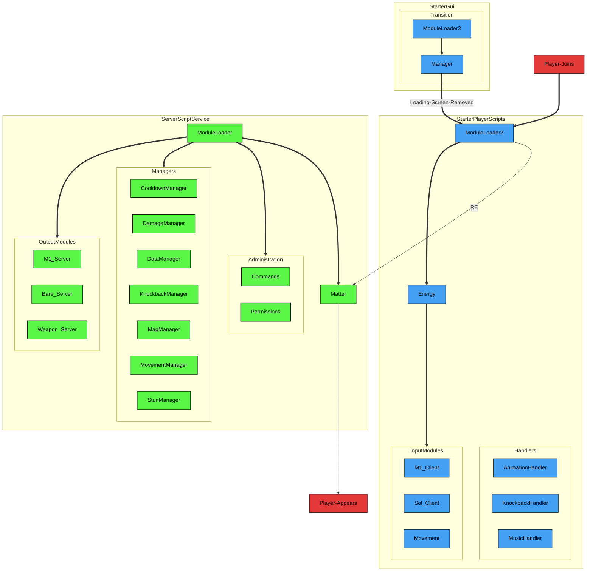
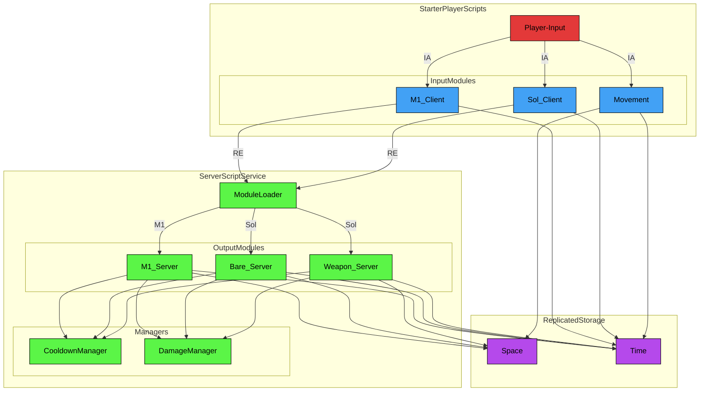
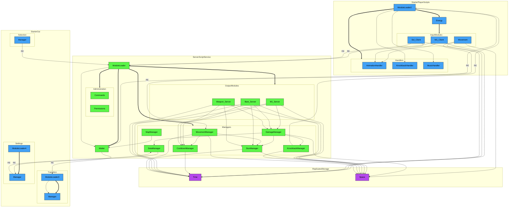

# Crusaders — Game
Crusaders is a 3D, free-for-all fighting game currently in beta and is available on Roblox! 

Not all of Crusaders' code is visible on this repo, so please refer to the [Source File](https://github.com/altair5607249/Crusaders-Game/blob/main/7077.rbxl) for everything, including the minor scripts!!! ***Assistive technology was used for production efficiency***; full credits for it can be found under [Credits & Disclosures](https://github.com/altair5607249/Crusaders-Game/blob/main/README.md#credits--disclosures) if you're interested in the specifics.

For those who wish to see the game's progress from before I added GitHub to my workflow, please refer to [The Timeline](https://github.com/altair5607249/Crusaders-Game-Timeline).

## Play the Game!
| Medium | Requirements | Compatibility | Status |
| --- | --- | --- | --- |
| Live Game | Roblox Account (Verified 16+) | PC & Mobile | [Active](https://www.roblox.com/games/123600574843310/Crusaders) |
| Source File | Roblox Account; Roblox Studio | PC | [Active](https://github.com/altair5607249/Crusaders-Game/blob/main/7077.rbxl)
| Unity | N/A | N/A | In Progress |

### Instructions  
- I have not met Roblox's Highly-Engaged Player (HEP) threshold, so the live game will be age restricted to 16+ until then
- You need a Roblox account to play the game, whether via Roblox itself or Roblox Studio; it only takes a few minutes to make if you don't already have one!
  - If you decide to play the public release of the game (the first link), you must verify that you're of 16 years or older
  - If you decide to open the binary place file (the second link), you must download Roblox Studio
 
## My Roles
Each job below is something I spent significant time on, listed in order of personal importance:
- Project Lead
- Lead Programmer
- Lead Animator
- Game Balance Designer
- Systems & Tools Engineer
- Map Designer
- Lead Narrative Designer
- UI/UX Designer
- Composer
- QA Tester

## Codebase
If you wish to view more diagrams than the three below, please refer to the [docs (WIP)](https://github.com/altair5607249/Crusaders-Game/blob/main/docs/diagrams.md).

### Legend
- Connections
  - Solid Line — Relation
  - Solid Arrow — Require
    - Arrow labels may specify otherwise, such as the following:
      - RE — Remote Event
      - IA — Input Action
  - Thick Arrow — Init
- Colors
  - Red — Event
  - Blue — Client
  - Green — Server
  - Purple — Universal
 
### Initialization

### Combat Flow

### Full System Diagram

### Functionality
(insert desc of every mechanic/module here later)

## Agent-Based Modeling
For those who wanna check out the simple ABM I worked on to optimize the game a bit, feel free to take a look [here](https://github.com/altair5607249/Crusaders-Game/tree/main/abm)!  

In short, it was a capricious choice made by me to algorithmically balance every character. I'd understood that the simple ABM was only useful for measuring baseline fairness, since further research brought me to the realization that I would need to employ many more concepts in machine learning to accrue accurate data.  

Its effects were small, in which only a few values (e.g., cooldown, damage, range) were tweaked, but the whole process meant a lot to me in terms of learning, even if I wasn't writing the majority of it (see [Credits & Disclosures](https://github.com/altair5607249/Crusaders-Game/blob/main/README.md#credits--disclosures)) and simply designing its agent logic for the most part.

## Constraints

## Credits & Disclosures
- Crusaders' full codebase is only visible in the [Source File](https://github.com/altair5607249/Crusaders-Game/blob/main/7077.rbxl)
  - The reason for this is that I couldn't properly save the content under certain services, like `StarterGui`
  - If you absolutely cannot access the the file, please refer to misc-scripts (WIP)!!!
- My Friends' Roles
  - Aidan ([@Trapizoid](https://www.pixilart.com/trapizoid)) — Lead Artist, Lead Composer, QA Tester
  - Jazz — QA Tester
  - Zachary () — Programmer, Artist, QA Tester, Map Designer, Narrative Designer, Voice Actor, Composer, Animator
  - Gabriel ([@NERailDude](https://www.youtube.com/@northeasttransitproductions)) — QA Tester
- AI (Claude & Gemini) Usage
  - Reviewing and suggesting code for the game
  - Writing code for the game, which was tweaked by me afterwards and occurred on two separate occasions:
    - Applying skins in `Matter`
    - Applying skins in `SelectionManager`
  - Writing code for the ABM, specifically
    - Mesa/Agent boilerplate 
    - Gymnasium/RL wrapper
    - Seaborn data visualization
- Tutorials
  - [RPG Tutorial by GnomeCode](https://www.youtube.com/playlist?list=PLtMUa6NlF10eTKSVlNrTiPRqiR87f-V1j)
  - [Roblox Advanced Scripting Tutorial Guide by BrawlDev](https://www.youtube.com/playlist?list=PLQ1Qd31Hmi3WKkVHnadvhOOjz04AuMYAf)
- Public Assets
  - Maps
    - [City 17](https://developer.valvesoftware.com/wiki/City_17) by [Valve Software](https://www.valvesoftware.com/en/) (Abeyant)
      - Can't find the original asset from the Creator Store, but it's literally an asset rip from Half-Life 2
      - The map won't be in the current rotation until Valve Software confirms with Zachary that it's okay to use their map
    - [Cyberpunk City](https://create.roblox.com/store/asset/11332829712/Cyberpunk-city) by [Animateria](https://sketchfab.com/Animateria)
    - [Floating Castle](https://create.roblox.com/store/asset/8673654426/Floating-Castle) by [J4milion](https://www.roblox.com/users/2236599004/profile)
    - [Former School](https://create.roblox.com/store/asset/8855189243/Former-School) by [Brendan](https://www.linkedin.com/in/brendan-o-brien-a6b1b4269/) & [RedManta LLC](https://www.redmanta.games/)
    - [Parking Lot](https://create.roblox.com/store/asset/11891234812/Repaved-Parking-Lot) by [Nicholas3285](https://www.roblox.com/users/113413962/profile) & [MinecraftPro97k](https://create.roblox.com/store/asset/11891234812/Repaved-Parking-Lot)
    - Station by MasonEpicBuilder2008
      - I, for the life of me, CANNOT find the original build, OR the builder...
    - [Town](https://create.roblox.com/store/asset/15996614363/Town-Map) by [CorruptTypes](https://www.roblox.com/users/1267741523/profile)
    - [Woodlands](https://create.roblox.com/store/asset/103509386196677/battlegrounds-map) by [Infexornn](https://www.roblox.com/users/1551586271/profile) & [CorruptTypes](https://www.roblox.com/users/1267741523/profile)
  - Props, SFX, & VFX
    - There are too many of these for me to list, but you can find all of them in the [Roblox Creator Store](https://create.roblox.com/store/)!
  - Music
    - [Memories](https://www.youtube.com/watch?v=WjzPrwieDHs) by [Dapper Husky](https://www.youtube.com/@DapperHusky)
    - [Final Transmission](https://music.apple.com/us/song/final-transmission/6783587437) by [Lazy Tunes](https://music.apple.com/us/artist/lazy-tunes/1807274042)
  - UI/UX
    - [Star's Shaders](https://create.roblox.com/store/asset/6980389129/Stars-Shaders) by [stxrryxnvght](https://www.roblox.com/users/536426235/profile)
    - [TopbarPlus](https://create.roblox.com/store/asset/92368439343389/TopbarPlus) by [ForeverHD](https://www.roblox.com/users/82347291/profile)
    - [Asadrith's Dialogue Kit](https://create.roblox.com/store/asset/18835619908/Asadriths-Dialogue-Kit) by [Asadrith](https://www.youtube.com/channel/UCSHDfp-fGeSeIP4j_Q_gKdA)
- Inspirations
  - [The Strongest Battlegrounds](https://www.roblox.com/games/10449761463/The-Strongest-Battlegrounds)
  - [Street Fighter 6](https://store.steampowered.com/app/1364780/Street_Fighter_6/)

## Roadmap
- Create a Unity version of Crusaders
- Add a state machine
- Merge `Bare_Server` and `Weapon_Server`
- Reduce collision latency
- Replace royalty-free music with custom music
