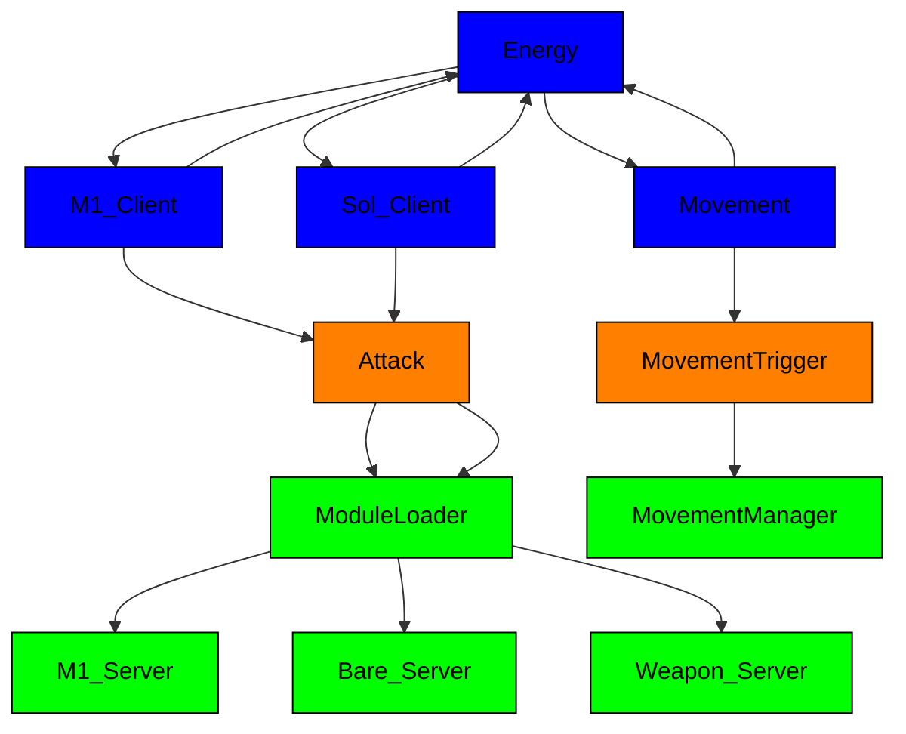

# Crusaders — Game
Crusaders is a 3D, free-for-all fighting game currently in beta and available on Roblox!

For those who wish to see the game's progress from before I added GitHub to my workflow, please refer to [The Timeline](https://github.com/altair5607249/Crusaders-Game-Timeline).

## Play the Game!
| Medium | Requirements | Compatibility | Status |
| --- | --- | --- | --- |
| Live Game | Roblox Account (Verified 16+) | PC & Mobile | [Active](https://www.roblox.com/games/123600574843310/Crusaders) |
| Source File | Roblox Account; Roblox Studio | PC | [Active](https://github.com/altair5607249/Crusaders-Game/blob/main/7046.rbxl)
| Unity | N/A | N/A | In Progress |

### Notes:  
- I have not met Roblox's Highly-Engaged Player (HEP) threshold, so the live game will be age restricted to 16+ until then.
- Currently working to create a Unity version of the game.
- You need a Roblox account to play the game, whether via Roblox itself or Roblox Studio; it only takes a few minutes to make if you don't already have one!
  - If you decide to play the public release of the game (the first link), you must verify that you're of 16 years or older.
  - If you decide to open the binary place file (the second link), you must download Roblox Studio.

## Codebase

(insert desc of every mechanic/module here later)

## Roadmap
- Add a state machine
- Merge `Bare_Server` and `Weapon_Server`
- Reduce collision latency
