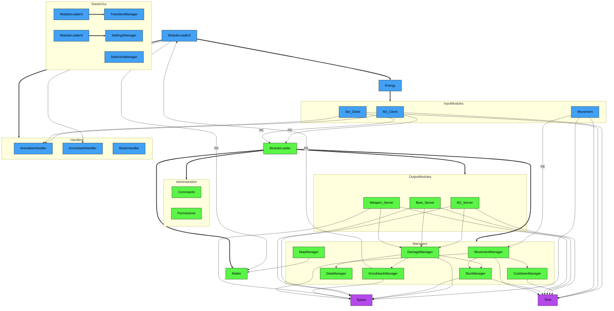

# Crusaders — Game
Crusaders is a 3D, free-for-all fighting game currently in beta and is available on Roblox! 

Not all of Crusaders' code is visible on this repo, so please refer to the [Source File](https://github.com/altair5607249/Crusaders-Game/blob/main/7046.rbxl) for everything, including the minor scripts!!! ***Assistive technology was used for production efficiency***, and full credits for it can be found under "Credits & Disclosures" if you're interested in the specifics.

For those who wish to see the game's progress from before I added GitHub to my workflow, please refer to [The Timeline](https://github.com/altair5607249/Crusaders-Game-Timeline).

## Play the Game!
| Medium | Requirements | Compatibility | Status |
| --- | --- | --- | --- |
| Live Game | Roblox Account (Verified 16+) | PC & Mobile | [Active](https://www.roblox.com/games/123600574843310/Crusaders) |
| Source File | Roblox Account; Roblox Studio | PC | [Active](https://github.com/altair5607249/Crusaders-Game/blob/main/7046.rbxl)
| Unity | N/A | N/A | In Progress |

### Notes  
- I have not met Roblox's Highly-Engaged Player (HEP) threshold, so the live game will be age restricted to 16+ until then.
- Currently working to create a Unity version of the game.
- You need a Roblox account to play the game, whether via Roblox itself or Roblox Studio; it only takes a few minutes to make if you don't already have one!
  - If you decide to play the public release of the game (the first link), you must verify that you're of 16 years or older.
  - If you decide to open the binary place file (the second link), you must download Roblox Studio.
 
## My Roles
Each job below is something I spent significant time on, listed in order of personal importance:
- Project Lead
- Lead Programmer
- Lead Animator
- Game Balance Designer
- Systems Designer
- Map Designer
- Lead Narrative Designer
- UI/UX Designer
- Composer
- QA Tester

## Codebase
### Legend
- Connections
  - Solid Line — Relation
  - Solid Arrow — Require
    - Arrow labels may specify otherwise, such as the following:
      - RE — Remote Event
  - Thick Arrow — Init
- Colors
  - Blue — Client
  - Green — Server
  - Purple — Universal

### Combat Flow

### Initialization

### Full System Diagram

### Functionality
(insert desc of every mechanic/module here later)

## Agent-Based Modeling
For those who wanna check out the simple ABM I worked on to optimize the game a bit, feel free to take a look [here](https://github.com/altair5607249/Crusaders-Game/tree/main/abm)!

## Constraints

## Credits & Disclosures
- Crusaders' full codebase is only visible in the [Source File](https://github.com/altair5607249/Crusaders-Game/blob/main/7046.rbxl)
  - The reason for this is that I couldn't properly save the content under certain services, like `StarterGui`
  - If you absolutely cannot access the [Source File](https://github.com/altair5607249/Crusaders-Game/blob/main/7046.rbxl), please refer to misc-scripts (WIP)!!!
- My friends, who are listed below, played so many roles of their own in this project; I couldn't have made it to Crusaders' open beta phase without them!
  - Aidan ([@Trapizoid](https://www.pixilart.com/trapizoid)) — Lead Artist, Lead Composer, QA Tester
  - Jazz — QA Tester
  - Zachary — Programmer, Artist, QA Tester, Map Designer, Narrative Designer, Voice Actor, Animator
  - Gabriel ([@NERailDude](https://www.youtube.com/@northeasttransitproductions)) — QA Tester
- AI was used for several things in this project, including the following:
  - Reviewing and suggesting code for the game
  - Writing code for the game, which was tweaked by me afterwards and occurred on two separate occasions:
    - Applying skins in `Matter`
    - Applying skins in `SelectionManager`
  - Writing code for the ABM, specifically:
    - Mesa/Agent boilerplate 
    - Gymnasium/RL wrapper
    - Seaborn data visualization
- Parts of these tutorials were referenced in the learning process:
  - [RPG Tutorial by GnomeCode](https://www.youtube.com/playlist?list=PLtMUa6NlF10eTKSVlNrTiPRqiR87f-V1j)
  - [Roblox Advanced Scripting Tutorial Guide by BrawlDev](https://www.youtube.com/playlist?list=PLQ1Qd31Hmi3WKkVHnadvhOOjz04AuMYAf)

## Roadmap
- Add a state machine
- Merge `Bare_Server` and `Weapon_Server`
- Reduce collision latency
