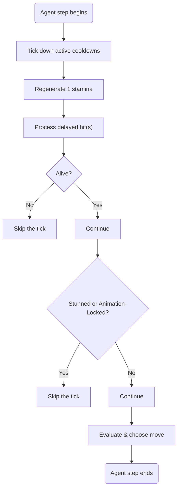

# Agent-Based Model (ABM)
Behold, Crusaders' simple ABM, which tests baseline character balance!

## Version History
| Version | Description | Status |
| --- | --- | --- |
| v1 | Bare-style-focused version. I designed the model + its agent behavior and directed the build, finding and fixing most of the problems myself. Much of the code was written with AI assistance (Claude and Gemini). | [Recovered](https://github.com/altair5607249/Crusaders-Game/blob/main/abm/abm_v1.ipynb?short_path=d9abe4e) |
| v2 | Weapon-style-focused version with batched matchups, per-move tallying, and a fixed RL wrapper. | [Partially recovered](https://github.com/altair5607249/Crusaders-Game/blob/main/abm/abm_v2.py) |
| v3 | Full rewrite by me. I'm aware that the ABM code is rushed and messy, so I will be working on a full rewrite without AI! | In progress |

## Codebase
All of the code for the second version of the ABM hasn't been recovered, so the diagram below will only be describing the general flow of the program, largely deriving from the first version of the ABM.

Also, this code is way shorter and simpler than [Crusaders' system](https://github.com/altair5607249/Crusaders-Game/blob/main/docs/diagrams.md), so I will only be using basic shape standards (see [ISO 5807:1985](https://cdn.standards.iteh.ai/samples/11955/1b7dd254a2a54fd7a89d616dc0570e18/ISO-5807-1985.pdf)).

### Legend
- Rounded Rectangle — terminator; the start or end of the program
- Rectangle — process; an action or task
- Rhombus — decision; yes/no branch point
- Ray — flow line; direction of the program's sequence

### Tick-Length Lifecycle

For reference, a single tick lasts 0.1 seconds.

## Constraints
- Time
  - Needed to be done in 2-3 days, so I could continue working on releasing Crusaders' open beta (v1 & v2)
- Scope
  - 1D simulations; only a single distance between agents
  - No auxiliary (aux) dash (v1 only)
- Estimations
  - Knockback and dash displacements are estimates from converting studs to fit 1D
  - Some moves' mechanics are simplified (e.g., Blue's/Bluee's Gamble)
  - Time moves in 0.1-second ticks, so moves with fast startups are rounded off and become inaccurate
- Agent Behavior
  - Agents pick moves using tag priority and randomness, not reinforcement learning (v1 only)
  - Agents pick moves using tag priority and reinforcement learning (v2+)
- Results' Meaning
  - Model output is not a proof of balance, and must be weighed against real playtest results
  - Against real playtest results, the model seems to be relatively accurate

## What is Agent-Based Modeling?
The University of Wisconsin-Madison (see [Agent-Based Evolutionary Game Dynamics](https://wisc.pb.unizin.org/agent-based-evolutionary-game-dynamics/chapter/i-3/)) has a lovely way of explaining this, so I'll be paraphrasing their content! 

Essentially, agent-based modeling is a way of simulating real-world systems. Such systems are made up by individual units (e.g., atoms, people, institutions) which repeatedly interact with each other and/or their environment!

## Why did I use Agent-Based Modeling?
Not because I enjoy torturing myself with my capriciousness, but for the love of the game (literally)!

I used basic intuition and experimental studies to balance the characters' stats, but I felt a little unconfident without empirical analysis to back up my numbers.

As I was researching ways to optimize the numbers with actual game theory, Agent-Based Modeling was one of the first and most promising solutions that came up! Trying it out seemed harmless and enriching, so I made it a side quest of mine to integrate the process of creating one into Crusaders' beta development pipeline.
