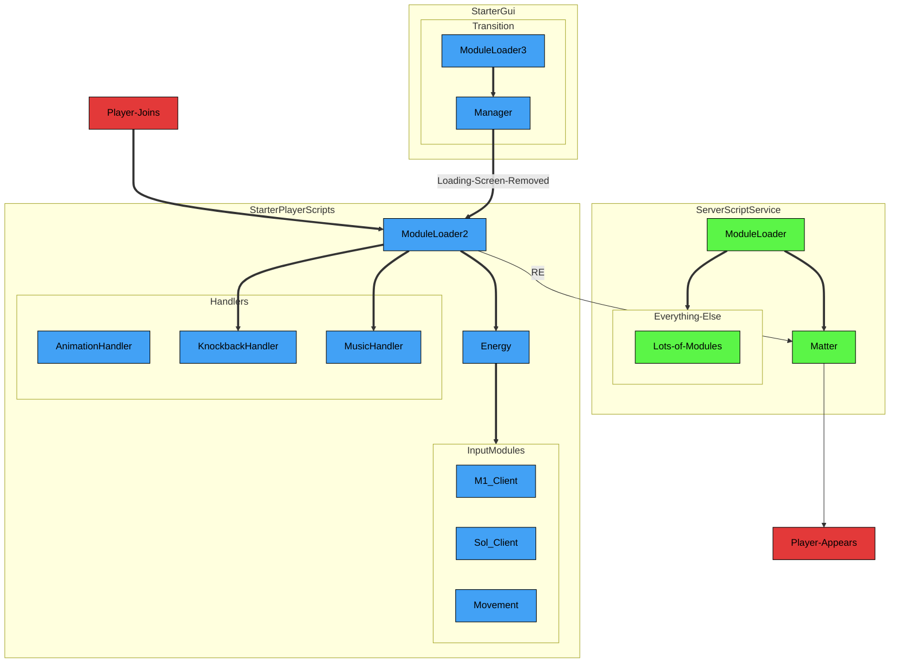
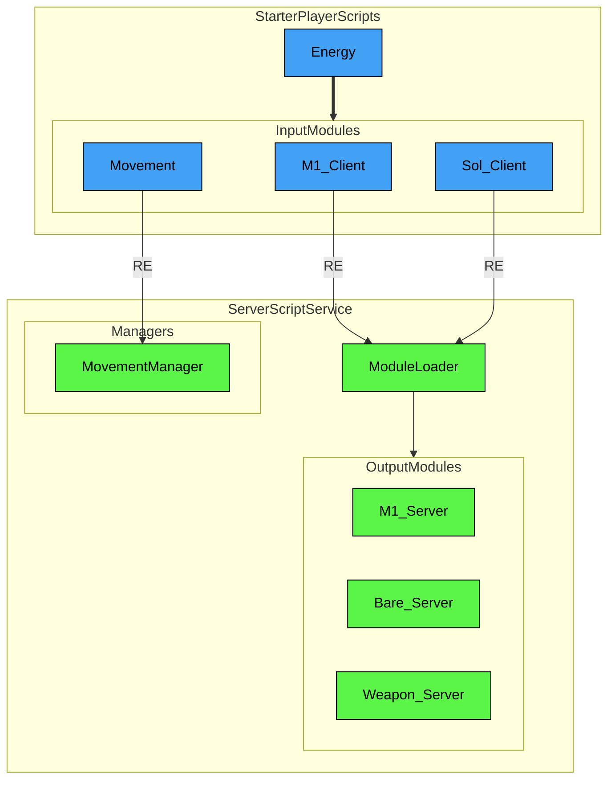
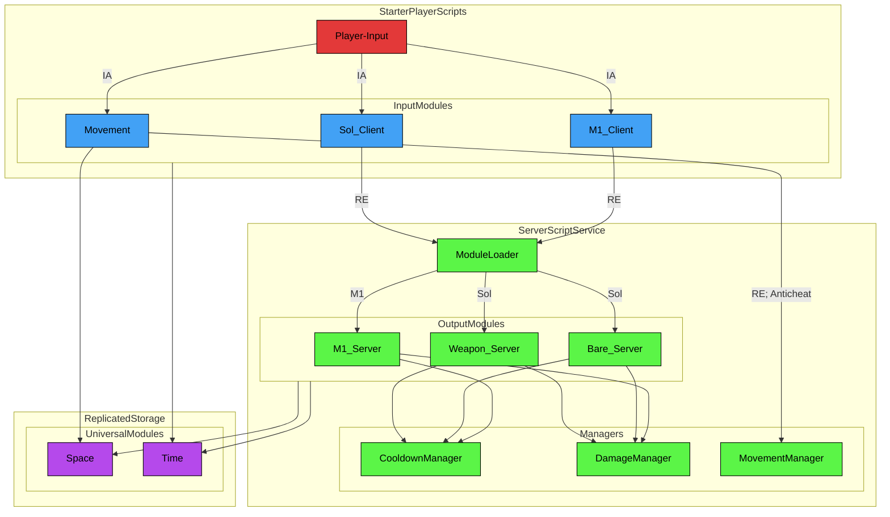
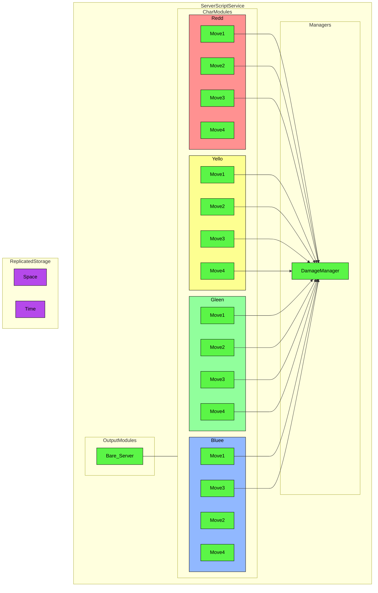
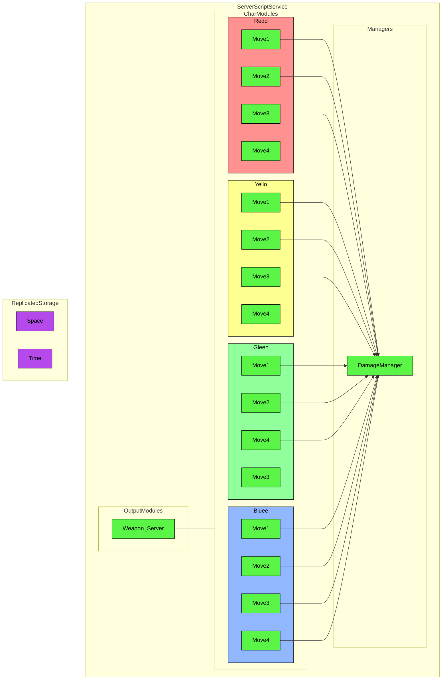
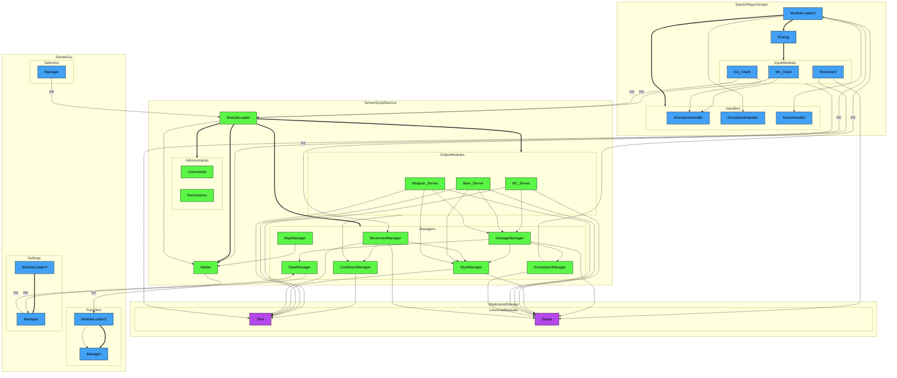

# Codebase
Important parts will be given in smaller diagrams, and everything, everywhere, all at once will be visible in the final diagram.

## Legend
- Connections
  - Solid Line — Relation
  - Solid Arrow — Require
    - Arrow labels may specify otherwise, such as the following:
      - RE — Remote Event
      - IA — Input Action
  - Thick Arrow — Init
- Colors
  - Blue — Client
  - Green — Server
  - Purple — Universal
 
## Initialization

## Client-Server Communication

## Combat Flow

## Bare-Style Flow

## Weapon-Style Flow

## Full System Diagram

