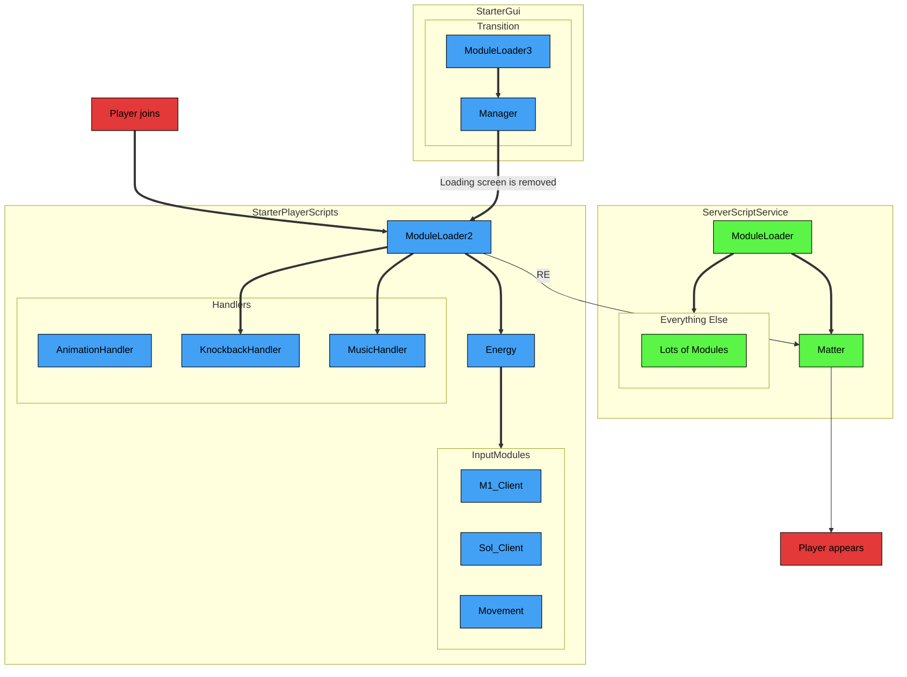
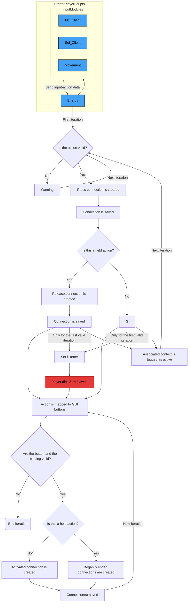
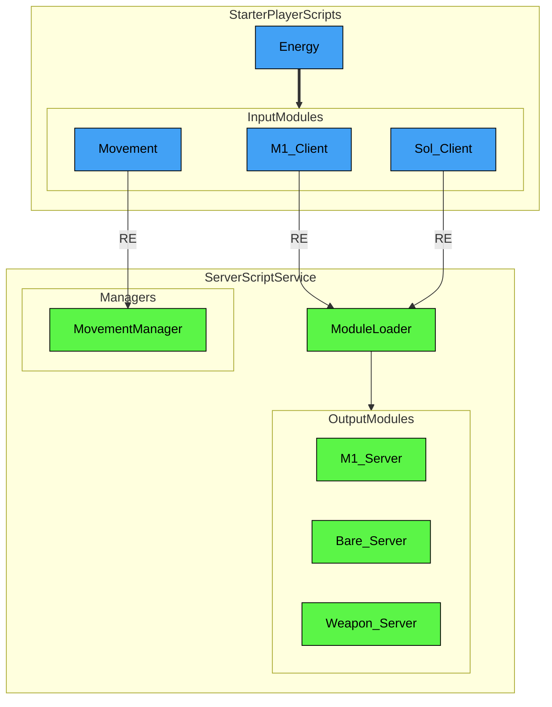
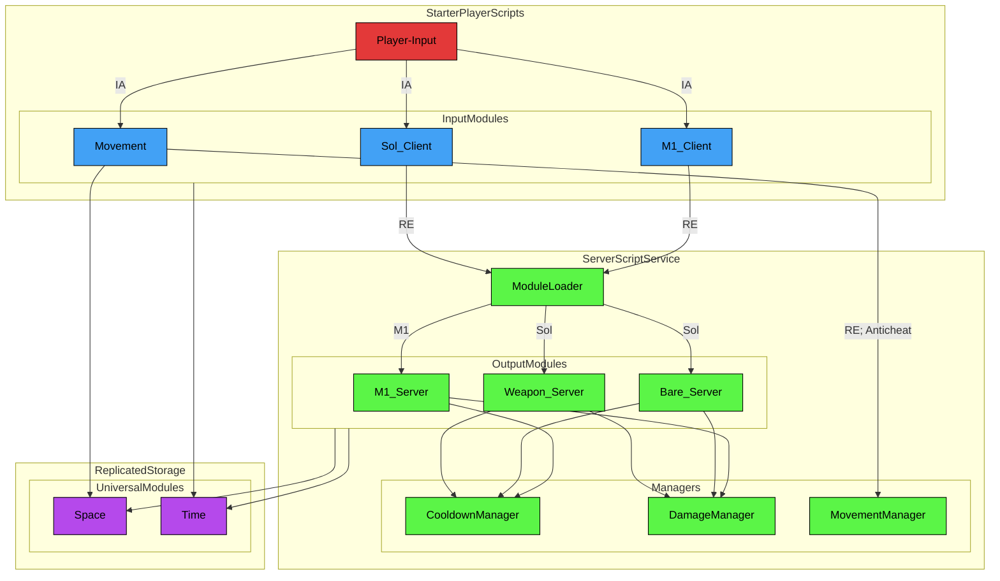
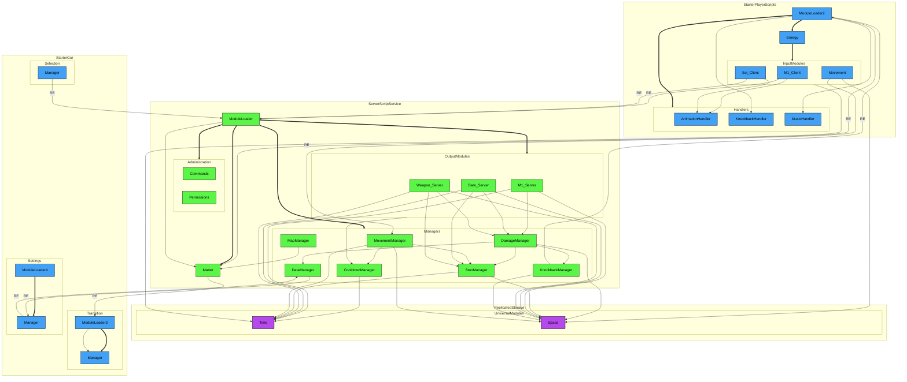

# Codebase
Important parts will be given in smaller diagrams, and everything, everywhere, all at once will be visible in the final diagram.

## Legend
- Connections
  - Solid Line — Relation
  - Solid Arrow — Require
    - Arrow labels may specify otherwise, such as the following:
      - RE — Remote Event
      - IA — Input Action
  - Thick Arrow — Init
- Colors
  - Red — Event
  - Blue — Client
  - Green — Server
  - Purple — Universal
- Shapes (standards derived from [ISO 5807:1985](https://cdn.standards.iteh.ai/samples/11955/1b7dd254a2a54fd7a89d616dc0570e18/ISO-5807-1985.pdf))
  - Rounded Rectangle — terminator; the start or end of the program
  - Rectangle — process; an action or task
  - Rhombus — decision; yes/no branch point
  - Ray — flow line; direction of the program's sequence
 
## Initialization

## Input Action System (IAS)

## Client-Server Communication

## Combat Flow

## Bare-Style Flow

```mermaid
flowchart TB;

  classDef serverNode fill:#5bf547,stroke:#000000,color:#000000
  classDef clientNode fill:#42a1f5,stroke:#000000,color:#000000
  classDef universalNode fill:#b549eb,stroke:#000000,color:#000000

  classDef redNode fill:#ff9191,stroke:#000000,color:#000000
  classDef yellowNode fill:#fdff91,stroke:#000000,color:#000000
  classDef greenNode fill:#91ff9c,stroke:#000000,color:#000000
  classDef blueNode fill:#91b8ff,stroke:#000000,color:#000000

  subgraph ServerScriptService
    subgraph Managers
      DamageManager;
    end

    subgraph OutputModules
      Bare_Server;
    end

    Bare_Server---CharModules

    subgraph CharModules
      subgraph Redd
        A["Move1"]-->DamageManager;
        B["Move2"]-->DamageManager;
        C["Move3"]-->DamageManager;
        D["Move4"];
      end 
      subgraph Yello
        E["Move1"]-->DamageManager;
        F["Move2"]-->DamageManager;
        G["Move3"]-->DamageManager;
        H["Move4"]-->DamageManager;
      end
      subgraph Gleen
        I["Move1"]-->DamageManager;
        J["Move2"]-->DamageManager;
        K["Move3"]-->DamageManager;
        L["Move4"]-->DamageManager;
      end 
      subgraph Bluee
        M["Move1"]-->DamageManager;
        N["Move2"];
        O["Move3"]-->DamageManager;
        P["Move4"];
      end 
    end
  end

  subgraph ReplicatedStorage
    subgraph UniversalModules
      Space;
      Time;
    end
  end

  Bare_Server-->UniversalModules;
  OutputModules-->Time;

  D-->Space;
  J-->Space;
  L-->Space;
  O-->Space;

  class ModuleLoader,M1_Server,Bare_Server,Weapon_Server,MovementManager,DamageManager,A,B,C,D,E,F,G,H,I,J,K,L,M,N,O,P,KnockbackManager,StunManager serverNode;
  class ModuleLoader2,Player-Input,M1_Client,Sol_Client,Movement,KnockbackHandler clientNode;
  class Space,Time universalNode;

  class Redd redNode;
  class Yello yellowNode;
  class Gleen greenNode;
  class Bluee blueNode;
```

## Weapon-Style Flow

```mermaid
flowchart TB;

  classDef serverNode fill:#5bf547,stroke:#000000,color:#000000
  classDef clientNode fill:#42a1f5,stroke:#000000,color:#000000
  classDef universalNode fill:#b549eb,stroke:#000000,color:#000000

  classDef redNode fill:#ff9191,stroke:#000000,color:#000000
  classDef yellowNode fill:#fdff91,stroke:#000000,color:#000000
  classDef greenNode fill:#91ff9c,stroke:#000000,color:#000000
  classDef blueNode fill:#91b8ff,stroke:#000000,color:#000000

  subgraph ServerScriptService
    subgraph Managers
      DamageManager;
    end

    subgraph OutputModules
      Weapon_Server;
    end

    Weapon_Server---CharModules

    subgraph CharModules
      subgraph Redd
        Q["Move1"]-->DamageManager;
        R["Move2"]-->DamageManager;
        S["Move3"]-->DamageManager;
        T["Move4"];
      end 
      subgraph Yello
        U["Move1"]-->DamageManager;
        V["Move2"]-->DamageManager;
        W["Move3"]-->DamageManager;
        X["Move4"];
      end 
      subgraph Gleen
        Y["Move1"]-->DamageManager;
        Z["Move2"]-->DamageManager;
        a["Move3"];
        b["Move4"]-->DamageManager;
        end 
      subgraph Bluee
        c["Move1"]-->DamageManager;
        d["Move2"]-->DamageManager;
        e["Move3"]-->DamageManager;
        f["Move4"]-->DamageManager;
      end 
    end
  end

  subgraph ReplicatedStorage
    subgraph UniversalModules
      Space;
      Time;
    end
  end

  Weapon_Server-->UniversalModules;
  OutputModules-->Time;

  X-->Space;
  a-->Space;
  b-->Space;
  
  class ModuleLoader,M1_Server,Bare_Server,Weapon_Server,MovementManager,DamageManager,Q,R,S,T,U,V,W,X,Y,Z,a,b,c,d,e,f,KnockbackManager,StunManager serverNode;
  class ModuleLoader2,Player-Input,M1_Client,Sol_Client,Movement,KnockbackHandler clientNode;
  class Space,Time universalNode;

  class Redd redNode;
  class Yello yellowNode;
  class Gleen greenNode;
  class Bluee blueNode;
```

## Full System Diagram

